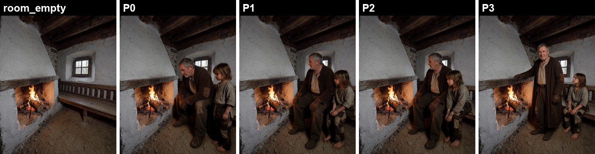
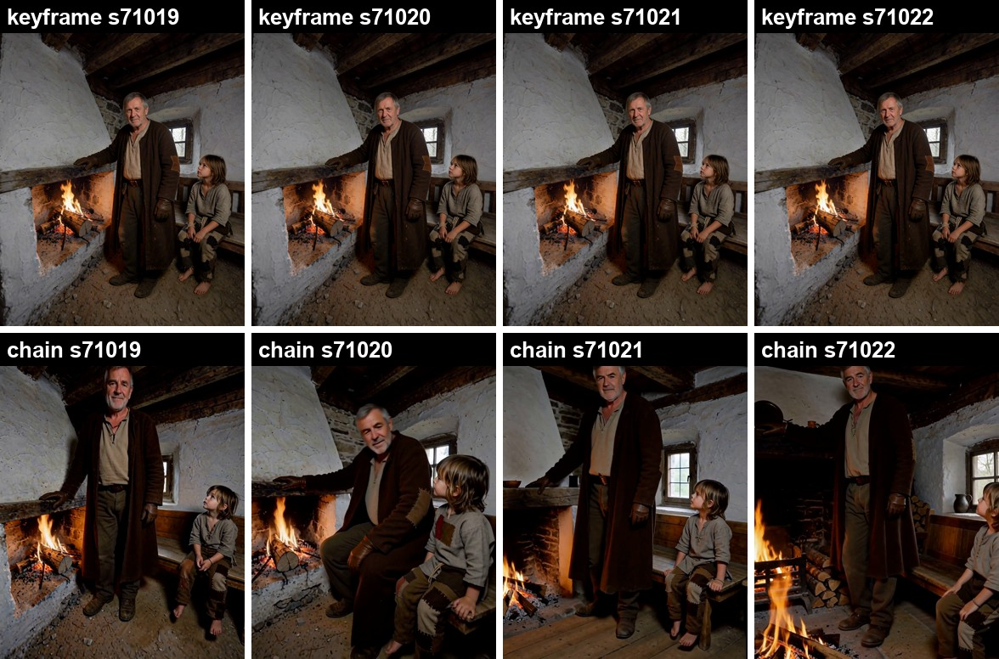
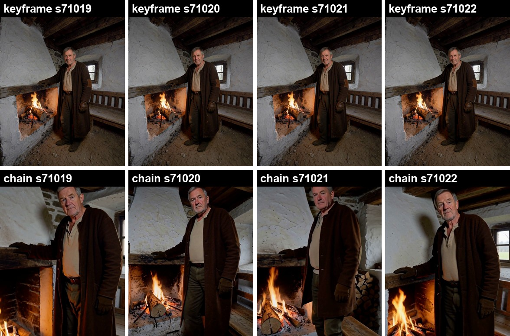

# Keyframe plates instead of chaining: holding a room steady across MiniMax H3 clips

A single image-to-video clip is about 10 seconds long, so a longer scene is usually built by **chaining**: each
clip starts from the last frame of the one before. Every defect gets passed on. A clip that drifts, darkens or cuts
away hands that state to the next clip, and by the third clip the room has been re-invented.

This repo tests a different approach, which works like a **screenplay**:

1. Render every keyframe of the scene as a still first (P0, P1, P2, P3), all in **one locked room**.
2. Render clip *k* with H3's first-and-last-frame mode, **from P(k-1) to P(k)**.
3. Neighbouring clips share a plate, so the end of one clip is the start of the next.

No clip ever starts from a generated frame, so a bad take stays inside its own clip.

**Result:** across 8 four-seed sequences (one character and two characters), the keyframe method ended with the
room within 3.0-3.5 grey levels of the original plate. Every chained control ended at 19-43 and had re-invented
the room. All the tests, clips, measurements and scripts are included.



*The two-character plates: the empty room, then P0-P3. Every plate has a pixel-identical room.*



*The last frame of each 30-second, 3-clip sequence, with the same prompts and seeds. Top row: keyframe plates.
Bottom row: chaining from the last frame.*

## Results

Each test used 4 seeds, 3 clips per sequence and 243 frames per clip (about 30 s per sequence), with both arms
on the same prompts and seeds. Pass criteria were written before any video was rendered (see [Method](#method)).

### One character (an old man, a cottage)

| | keyframe plates | chain |
|---|---|---|
| room drift at the end (mean abs. difference vs the empty plate, top of frame) | **3.0-3.1** (4/4) | 28-43 (4/4) |
| near-black share of the last frame | ~37% | 48-55% |
| clips with a hard cut | 1 of 12 | 1 of 12 |
| room at the end | the plate's room | re-invented on all 4 seeds |

In the chain arm the hard cut became permanent: the chain jumped to an invented close-up in a different room 0.3 s into
clip 2 and never came back. The keyframe cut (seed 71021, clip 2) went out to a close-up and back to the plate
six seconds later.



### Two characters (the old man and a boy)

| | keyframe plates | keyframe + "one continuous shot" line | chain |
|---|---|---|---|
| room drift at the end | **3.4-3.5** (4/4) | **3.4** (4/4) | 19-26 (4/4) |
| near-black share of the last frame | ~38% | ~38% | 46-62% |
| clips with a hard cut | 3 of 12 | **1 of 12** | 1 of 12 |
| identity (merge, swap, extra or missing person) | none | none | (not graded) |

With two people in frame, H3 started inserting **coverage cut-ins**: it cut to a close-up mid-clip and back to the
wide plate before the end. Adding one sentence to every prompt reduced them from 3 of 12 clips to 1 of 12:

> The whole clip is one continuous, unbroken shot from one fixed camera.

The remaining cut-in is on the same seed and at the same place as before (seed 71021, clip 2), so in practice that
clip would be re-rolled with another seed.

Joins between clips measured 0.25-0.83x a normal frame-to-frame step in every keyframe sequence: invisible.

Raw numbers: [`results/`](results). Videos (4 seeds side by side):
- [one character, keyframe top / chain bottom](media/one_character_4seeds_keyframe_top_chain_bottom.mp4)
- [two characters, keyframe top / chain bottom](media/two_characters_4seeds_keyframe_top_chain_bottom.mp4)
- [two characters, keyframe with the one-continuous-shot line](media/two_characters_4seeds_keyframe_with_no_cut_line.mp4)

## Known limits

- **The camera still breathes inside a clip.** Over a 10 s window H3 drifts in toward the people. Both ends are
  pinned to wide plates, so it drifts in and comes back out, and mid-clip the room can stray 3-8x further than
  at the end. Rewording the camera instruction does not stop it. In earlier tests a 5 s (123-frame) window did not
  push in, so shorter clips with more plates should reduce it; that has not been tested here.
- **H3 still chooses the route between plates.** In one take the man walked toward the lens before sitting down.
  The damage stays inside that clip.
- **The plates have to carry the whole story state.** H3 drops anything the end plate lacks (a wound, a prop, bare feet).
- **Not tested:** camera angle changes between plates, more than 3 clips, dialogue, or three or more people.
- **n = 4 seeds per test**, one room, one locked camera, on one machine.

## Method

### Plates
1. **Empty room.** One photoreal still of the empty set at the video's size (864x1152 portrait here). This one is
   a view cut from a generated 360° panorama of the set, given a Krea 2 photoreal pass; any good still works.
2. **Cast each pose.** An edit model adds the character to the empty room from a character-sheet reference image,
   using one plain sentence per pose. A Krea 2 identity-edit setup was used, with 4 seeds per pose and one picked.
   The sentences are in each example's `prompts.json`. Seeds that broke identity (the man grew a beard on 1-2
   seeds in 4) were rejected.
3. **Lock the room.** [`scripts/seg_lock.py`](scripts/seg_lock.py) pastes the empty room back over everything
   except the person, so every plate has an identical room.
4. **Second character.** Cast person B into person A's *locked* plate, never into the empty room. Cast alone, the
   boy was placed on the man's spot 4/4. Then [`scripts/compose.py`](scripts/compose.py) builds the plate: the empty
   room, then A from A's own locked plate, then B from the duo cast. B's mask never covers A, so the edit model's
   redrawn copy of A cannot overwrite the locked A. Two wording lessons:
   - "with a gap of empty bench between him and the man" kept them apart; "away from the man" alone did not.
   - Name what the look depends on. Without "barefoot" the boy got boots in 3 of 4 plates.
5. **Check the set** side by side before any video: same room, identity at full size, story state carried, no
   overlap, and each pose step small enough for one clip.

### Clips
- MiniMax H3 FL2VA (first + last frame to video with audio), 864x1152, 243 frames at 24 fps, 8 steps. The API graph is in
  [`graph/h3_fl2va_api.json`](graph/h3_fl2va_api.json).
- [`scripts/render_clips.py`](scripts/render_clips.py) runs either arm. The chain control starts each clip from the
  previous clip's exact last frame, selected by frame index (`ffprobe -count_frames`) and logged by md5.
- Prompts: give every person in frame an identity clause, say who stays on which side and that neither crosses
  in front of the other, add the one-continuous-shot line, and keep the audio to ambience.

### Joining and measuring
[`scripts/join_measure.py`](scripts/join_measure.py):
- **Join:** drop frame 0 of every clip after the first (it repeats the shared plate) and trim 1/24 s of that
  clip's audio.
- **Splice (hard cut):** a per-frame grey RMS step more than 3x the clip's median, with neighbours (±2 frames)
  below 2x. An isolated spike is a cut; a run of high steps is fast motion. Look at the frames before acting on one.
- **Room drift:** mean absolute difference between the last frame and the empty plate, over the top 170 rows at
  432x576 (ceiling beams and upper wall, which no person reaches), plus the near-black share of the frame.

The published script reproduces every number in `results/` from the original clips.

### Pre-registered pass criteria
The keyframe arm passes if it has hard cuts in at most 1 of 12 clips, AND less room drift than the chain on at least 3 of
4 seeds, AND no identity failure in more than 1 of 12 clips (for one character: identity at least as good as the chain). One character: passed. Two characters: failed on cuts
(3/12), then passed with the one-continuous-shot line (1/12), which was added afterwards as a follow-up.

## Running it

Requirements: ComfyUI with the MiniMax H3 nodes and models named in the graph, ffmpeg/ffprobe on PATH, Python with
numpy and Pillow, and `ultralytics` plus a person-segmentation checkpoint (set `YOLO_SEG`) for the plate scripts.

```bash
# plates (after casting each pose with your edit model)
python scripts/seg_lock.py room_empty.png locked/ cast_pose1.png cast_pose2.png
python scripts/compose.py room_empty.png P1.png locked/A_pose_seg.png duo_cast_B.png

# clips: examples/<name>/plates/P0..Pn.png + prompts.json
python scripts/render_clips.py examples/two_characters K 71019 71020 71021 71022
python scripts/join_measure.py examples/two_characters K 71019 71020 71021 71022
```

Set `COMFY_URL` to use a remote ComfyUI (for example through an SSH tunnel).

Timing on an RTX 5070 Ti 16 GB (shared with other work): about 5 min per 243-frame clip; about 2 min on an RTX PRO 6000.
The four plates for the two-person scene took 30-40 min including re-casts.

## Licence

Code (`scripts/`, `graph/`): MIT, see [LICENSE](LICENSE). Images, videos and text: CC BY-NC 4.0, see
[LICENSE-CONTENT](LICENSE-CONTENT). The models used (Krea 2, MiniMax H3) have their own licences; read the MiniMax H3
Community License before using H3, as it restricts where the model may be used.
